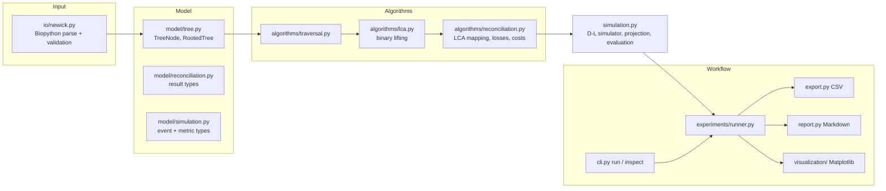
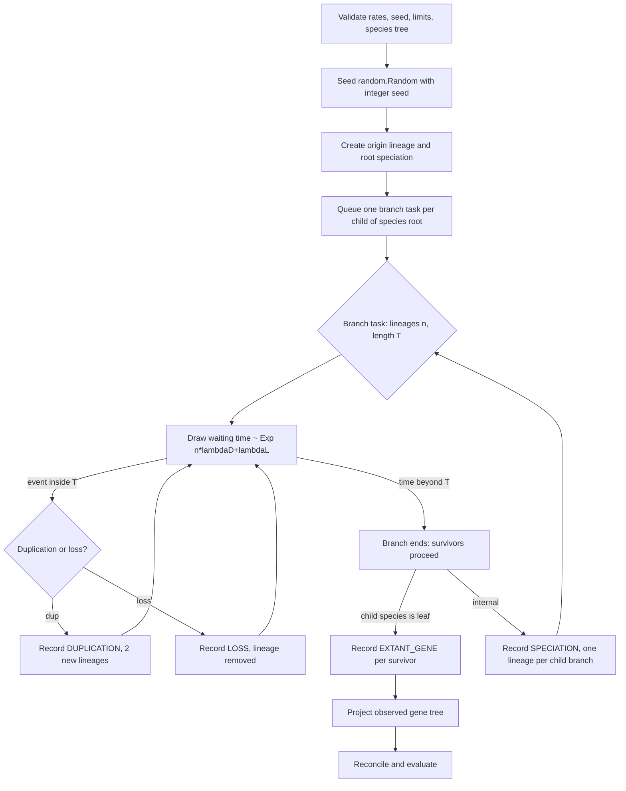
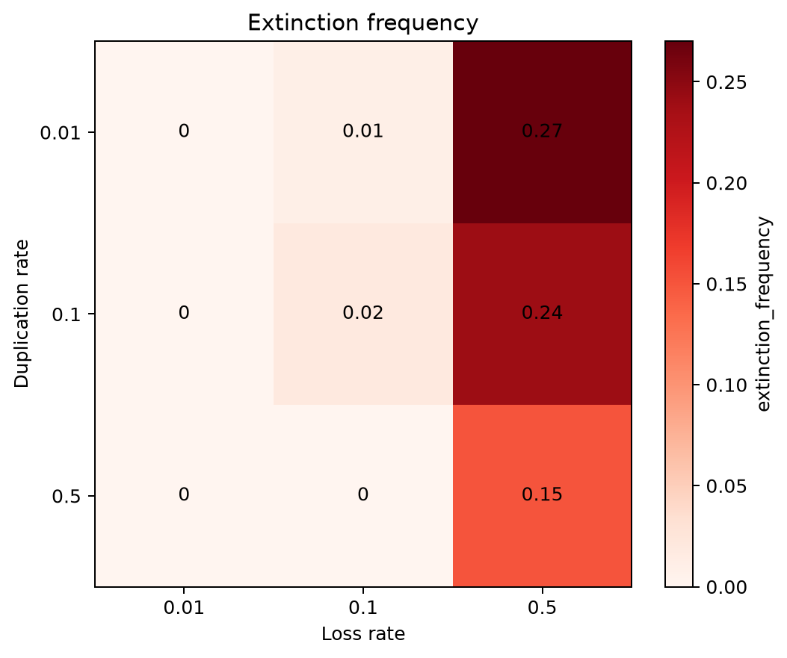
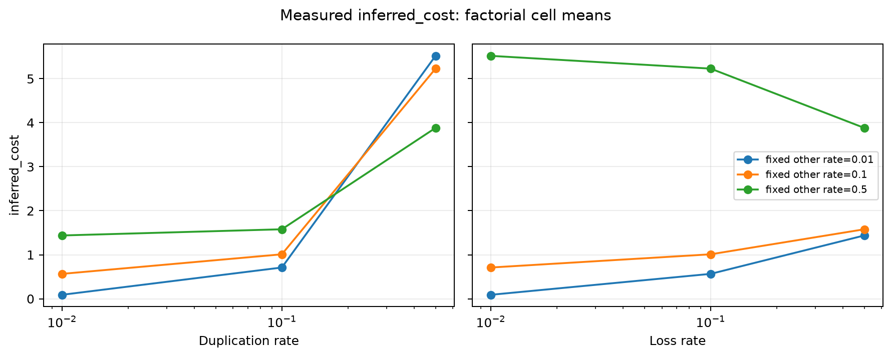

# PhyloBench: An Inspectable Reference Implementation for Duplication–Loss Reconciliation

**Authors:** [AUTHOR NAMES — TO BE SUPPLIED]
**Affiliations:** [TO BE SUPPLIED]
**Correspondence:** [TO BE SUPPLIED]

> **Pre-submission items requiring author action:** author names, affiliations, correspondence details, funding, acknowledgements, and author contributions have not been supplied. Generative AI assistance was used for research assessment and prose editing; before submission, authors should disclose the tool/model and scope as required by the selected venue and verify the final manuscript. The repository also lacks a software license and citation metadata. No missing author, funding, usage, or licensing details are inferred here.

---

## Abstract

**Motivation:** Reconciliation benchmarks need to distinguish events in a complete simulated history from those identifiable in the extant gene tree. **Approach:** We describe PhyloBench, a Python reference implementation of rooted-tree handling, LCA-based duplication–loss reconciliation, seeded simulation, and event evaluation, and summarize two archived exploratory studies on one four-species tree with equal branch lengths. **Results:** Across both studies, 54 pilot executions comprise 9 Study 1 records and 45 Study 2 records; all repeat seed/cell combinations in the full-run files. Study 2 contains 900 trials, of which 69 are extinct and 831 support inferred metrics. At duplication and loss rates of 0.5, mean branch-level loss recall is 0.590 under the evaluator's empty-denominator convention, but 0.559 among 79 of 85 valid trials with non-empty recall denominators. **Interpretation:** These descriptive results are conditional on one topology, one branch-length setting, the simulator, and the seed design. PhyloBench introduces no new reconciliation algorithm, and the repository does not contain the complete original study-generation pipeline. External software validation, gene-tree estimation error, and broader simulation designs remain unaddressed.

**Keywords:** gene-tree/species-tree reconciliation; gene duplication and loss; lowest common ancestor; phylogenetic simulation; software; exploratory evaluation

---

## 1. Introduction

Gene trees describe the histories of gene copies, while species trees describe the histories of the organisms that carry them. Duplication and loss, horizontal gene transfer, and incomplete lineage sorting can cause gene-tree/species-tree discordance (Maddison, 1997; Szöllősi et al., 2015). Under a duplication–loss model, reconciliation maps a gene tree into a species tree and counts events under specified conventions (Goodman et al., 1979; Page, 1994; Doyon et al., 2011). The method and simulator described here address only vertical inheritance with duplication and loss.

Evaluating reconciliation against simulated truth requires a distinction between the complete history and events identifiable from extant genes. Events on lineages with no surviving descendants cannot generally be recovered from the extant tree; treating them as ordinary misses conflates information loss with method error. Conversely, metric conventions for empty denominators can make an average look favorable when there was no event to evaluate. Both distinctions matter for interpreting the results presented here.

PhyloBench is a Python package that places rooted-tree validation, LCA-based reconciliation, duplication–loss simulation, and evaluation in one inspectable implementation. The package combines established algorithms; it does not propose a new reconciliation method, LCA algorithm, or evolutionary model. Its contribution is as a compact reference implementation with explicit event and metric conventions, tests, and archived example datasets. This framing is narrower than a claim of a new biological inference method.

The paper also provides a descriptive account of two archived simulations. We organize that account around two retrospective exploratory questions, not prespecified confirmatory hypotheses:

1. Across the tested duplication/loss rate grid, how do extinction and complete-history event counts vary, and how do inferred costs among surviving families compare with complete counts?
2. How do branch-level loss precision and recall vary across the grid when metric means are interpreted with their valid-trial counts and non-empty event denominators?

These questions summarize the existing archive; they do not imply that the studies were designed or powered to test causal effects or generalize across species-tree designs.

## 2. Background and Related Work

**Reconciliation.** Goodman et al. (1979) described parsimony reconciliation; Page (1994) formalized reconciled-tree mappings, and Page and Charleston (1997) discussed the gene-tree/species-tree problem. Zmasek and Eddy (2001) presented an algorithm for classifying internal gene-tree nodes as duplication or speciation events. Doyon et al. (2011) reviewed reconciliation models and software, including models with horizontal transfer. Reconciliation also depends on tree quality: Hahn (2007) documented biases that arise when reconciling incorrect gene trees.

**Duplication–loss as a stochastic process.** Gene-family evolution along a species tree is commonly modeled as a birth–death process in which lineages duplicate and are lost at specified rates (Szöllősi et al., 2015). Related models account for incomplete lineage sorting through a locus tree (Rasmussen and Kellis, 2012) or include transfer (Szöllősi et al., 2015; Morel et al., 2020).

**Simulation and inference software.** SimPhy simulates gene, locus, and species trees under multiple processes, including incomplete lineage sorting, duplication and loss, transfer, and gene conversion, and can generate sequence alignments (Mallo et al., 2016). GeneRax infers gene-family trees from sequence alignments under duplication, transfer, and loss (Morel et al., 2020); Boussau et al. (2013) describe a probabilistic framework for joint species-tree and gene-tree inference. These programs address broader evolutionary or inference problems than PhyloBench. PhyloBench instead puts a classical duplication–loss simulator, reconciler, and truth-based evaluator in a small package whose conventions can be inspected together. This is a scope distinction, not a claim of comparative advantage. We did not benchmark PhyloBench against these or other tools.

**Tree algorithms.** LCA queries on rooted trees can be answered with constant query time after linear preprocessing (Bender and Farach-Colton, 2000). PhyloBench uses binary lifting, with logarithmic query time; the alternatives were not benchmarked. Newick parsing is delegated to Biopython's `Bio.Phylo` (Talevich et al., 2012).

## 3. Materials and Methods

### 3.1 Software architecture

PhyloBench (version 0.1.0) is a Python ≥ 3.10 package with two runtime dependencies, Biopython (≥ 1.81) and Matplotlib (≥ 3.7). Its modules are organised as follows (Figure 1).

*Figure 1. Module structure of PhyloBench (to be redrawn for publication). Arrows indicate the direction of data flow, not Python import order.*

The implementation validates trees before processing, accepts an integer seed, keeps complete event history separately from the projected observed tree, and raises an exception when configured simulation limits would be exceeded. Automated tests cover the tree model, parsing, traversal, LCA, reconciliation, simulation invariants, CLI, export, reports, and figures. GitHub Actions run 41027204289 at main commit `2e4845529bcf6f3ce1af139c556ea0977a108939` passed on Python 3.10–3.13. The Python 3.12 job reports 64 test items. These results establish software test coverage at that revision, not external scientific validation or reproduction of the archived experiment-generation pipeline.

### 3.2 Tree representation and LCA

A `TreeNode` carries a stable non-negative integer identifier, an optional label, an optional branch length, a parent reference, and an ordered child list. A `RootedTree` is defined by its root. Adding a child is rejected if it would create a cycle, attach a second parent, or place a node in two trees. Calling `freeze()` (done automatically when an LCA index is built) forbids later topology changes. `validate_tree` iteratively verifies parent pointers, identifier uniqueness, branch-length validity, leaf-name presence and uniqueness, and, optionally, that every internal node has exactly two children.

Newick input is parsed with Biopython. Before parsing, PhyloBench requires exactly one tree with a single terminal semicolon and rejects empty, malformed, negative, or non-finite branch lengths. The Biopython clade structure is then converted to the internal model with an explicit stack, and the result is validated. Pre-order and post-order traversals are likewise iterative, so deep trees do not exhaust the Python recursion limit; the test suite includes a deep-tree case.

For LCA queries, `LCAIndex` stores node depths and a table `up[k][v]` holding the 2^k-th ancestor of node *v* (the root is its own ancestor). A query first lifts the deeper node to the depth of the shallower one using the binary representation of the depth difference, and, if the nodes then differ, lifts both simultaneously from the largest level downward. By code inspection, table construction uses O(*n* log *n*) time and space and each query uses O(log *n*) time for a tree with *n* nodes. We did not measure scaling empirically.

### 3.3 Reconciliation methodology

**Model and assumptions.** Let *S* be a rooted binary species tree with root ρ, node depth δ(·) (the number of edges from ρ), and leaf set *L(S)*. Let *G* be a rooted binary gene tree with leaf set *L(G)* and an explicit leaf-to-species map σ : *L(G)* → *L(S)*. The implementation assumes complete taxon sampling and vertical inheritance only (speciation, duplication, loss). Both trees must be binary, and PhyloBench raises an error if a gene leaf has no mapping or maps to an unknown species. If no mapping is supplied, gene-leaf names must equal species-leaf names.

**LCA mapping.** The map *M* : *V(G)* → *V(S)* is defined by *M(g)* = σ(*g*) for a leaf and *M(g)* = LCA_*S*(*M(g₁)*, *M(g₂)*) for an internal node *g* with children *g₁* and *g₂*, computed in post-order. An internal node is classified as a **duplication** if *M(g)* ∈ {*M(g₁)*, *M(g₂)*} and as a **speciation** otherwise.

**Loss inference.** The family is assumed to originate at ρ. For every transition from a gene node *g* to a child *g′*, let *u* = *M(g)* and *w* = *M(g′)*; *w* is a descendant of *u* (or equal to it). Walking the species-tree path from *u* to *w*, one loss event is recorded on each species branch that leaves the path, that is, at each split on the path the sibling branch not taken. Following the implemented convention, a duplication transition counts the split at *u* itself, whereas a speciation transition skips it, because that split is the speciation already represented in *G*. The family-origin transition runs from ρ to *M(root of G)* and counts all splits. Each loss is stored as a (species-parent, species-child) branch together with the gene transition that produced it, so that two independent copies lost on the same branch produce two records. Because *S* is binary, each counted split contributes exactly one loss, and the loss count simplifies to

Λ = [δ(*M(r_G)*) − δ(ρ)] + Σ_{(g,g′)∈E(G)} [ δ(*M(g′)*) − δ(*M(g)*) − *s(g)* ],

where *r_G* is the root of *G*, *E(G)* is the set of parent–child edges of *G*, and *s(g)* = 1 if *g* is a speciation and 0 if it is a duplication. With *D* the number of duplications, the reconciliation cost is

*C* = *c_D* · *D* + *c_L* · Λ,

where *c_D* and *c_L* are non-negative duplication and loss costs (both 1 in the studies reported here). By code inspection, mapping takes O(*g* log *s*) for *g* gene nodes and *s* species nodes, while enumerating species-tree paths for losses takes O(*g h*) in the worst case for species-tree height *h*. This is a source-level complexity analysis, not an empirical scaling result; no scaling benchmarks are archived.

**Worked example.** The test suite encodes the following case (Table 1). With species tree `((A,C)X,B)R` and gene tree `(((A1,C1)s,A2)d2,A3)d1`, where A1, A2, A3 map to A and C1 maps to C, the reconciler assigns *s* to speciation at X and both *d2* and *d1* to duplications mapped to X. The origin transition from R to X contributes one loss on branch (R, B); the two duplication transitions to A2 and A3 each contribute one loss on branch (X, C). Thus *D* = 2, Λ = 3, and *C* = 5 under unit costs. Two losses on the same species branch remain separate records.

**Table 1. Worked reconciliation example (from `tests/test_reconciliation.py`).**

| Gene node | Event | Mapped species node |
|---|---|---|
| s | speciation | X |
| d2 | duplication | X |
| d1 | duplication | X |

| Loss branch (parent, child) | Count |
|---|---:|
| (R, B) | 1 |
| (X, C) | 2 |

The loss convention is covered by hand-derived cases in the test suite; we did not cross-validate it against external reconciliation software.

### 3.4 Evolutionary simulation model

**Process.** The simulator evolves one gene family along a fixed, rooted, binary species tree whose non-root nodes have positive finite branch lengths (interpreted as time). Let λ_D and λ_L be the per-lineage duplication and loss rates, constant in time and across branches. On a branch of length *T* entered by *n* active lineages, the waiting time to the next event is exponential with rate *n*(λ_D + λ_L); if the event time would fall beyond *T*, the branch ends. Otherwise a lineage is chosen uniformly at random; with probability λ_D / (λ_D + λ_L) it duplicates (replaced by two daughter lineages) and otherwise it is lost. Because the exponential distribution is memoryless, this is equivalent to independent linear birth–death processes on each lineage. If λ_D + λ_L = 0 no events occur. Species-tree speciation is deterministic: at the end of an internal branch every surviving lineage splits into one lineage per child species. A virtual origin lineage is created above ρ and undergoes the root speciation (Figure 2).

*Figure 2. Simulation workflow. Event and lineage limits are checked whenever an event or lineage is created.*

**Complete history and observed tree.** Every origin, speciation, duplication, loss, and extant-gene event is stored with its gene node, lineage, species branch, and time on the branch. The *observed gene tree* is obtained by removing the virtual origin, discarding subtrees that contain no extant gene, and collapsing nodes left with a single child, while preserving the original node identifiers. If no extant gene survives, the family is **extinct** and no observed tree exists.

**Limits.** If recording another event would exceed `max_events`, or allocating another lineage would exceed `max_lineages` (defaults 100,000 and 10,000), the simulator raises `SimulationLimitExceeded`. `run_experiment` does not catch this exception, so a violating trial aborts the run rather than returning a silently truncated family.

**Reproducibility.** Randomness comes from Python's `random.Random(seed)` with an integer seed, and fixed-seed repeatability is covered by a test. The experiment metadata records the study configurations and seeds. The repository does not include the original scripts for generating the complete study artifacts or a dependency lockfile, and cross-version identity of random streams is unverified. The archived records can be inspected and summarized; this should not be read as a claim that the full original study pipeline is packaged for exact regeneration.

### 3.5 Evaluation metrics

For a non-extinct trial, the observed tree is reconciled with the species tree using the leaf-to-species map recorded during simulation, and the following quantities are computed. Let *V_obs* be the internal nodes of the observed tree. Each *v* ∈ *V_obs* has a true type (speciation or duplication) and a true species location from the complete history, and an inferred type and location *M(v)* from reconciliation.

- **Event counts and cost.** Inferred duplications *D̂*, inferred losses Λ̂, and inferred cost *Ĉ* from Section 3.3, alongside *complete* simulated duplication and loss counts. Complete counts include events invisible in the extant tree (for example, a duplication whose descendants were all lost).
- **Exact speciation-location agreement.** Among nodes whose true and inferred types are both speciation, the fraction with *M(v)* equal to the true species node. This is the quantity stored as `exact_event_location_agreement`; despite the name, it applies to speciation nodes only.
- **Duplication branch compatibility.** Among nodes whose true and inferred types are both duplication, the fraction for which *M(v)* equals or lies below *c(v)*, the child end of the species branch on which the duplication occurred. This does not establish recovery of the exact duplication time, which is not identifiable from extant leaves.
- **Loss precision and recall.** Let Î be the multiset of species branches carrying inferred losses. A simulated loss is *identifiable* if the lineage that was lost was created by a speciation or duplication split in which at least one sibling lineage has an extant descendant; let *I* be the multiset of species branches of identifiable losses. Precision is |Î ∩ *I*| / |Î| and recall is |Î ∩ *I*| / |*I*|, using multiset intersection. When a denominator is empty the implementation returns 1.0. The same convention applies to exact speciation-location agreement and duplication-branch compatibility when their evaluated event denominators are empty. A convention-assigned 1.0 is not evidence of event recovery. Hidden losses are excluded from recall rather than counted as misses. Matching branches does not establish exact historical loss-event recovery.

The evaluator also computes the number of type-matched nodes and the signed duplication-count error, but the experiment runner does not write these to the trial CSV; they are therefore not analysed here (Section 6).

### 3.6 Experimental design

Both studies use the rooted, balanced four-species tree `((A:1,B:1)AB:1,(C:1,D:1)CD:1)ROOT;`, unit duplication and loss costs, and limits of 100,000 events and 10,000 lineages (Table 2). Each trial is one simulated family. Study 1 contains 30 full-run trials across three equal-rate conditions; Study 2 contains 900 trials across nine duplication/loss-rate combinations. The pilot archives contain 54 executions in total: 9 in Study 1 (seeds 101–103 in each of three tiers) and 45 in Study 2 (seeds 1001–1005 in each of nine cells). In each study, these pilot seed/cell combinations are included again in the corresponding full-run files, so they add no trial rows: the full datasets contain 30 and 900 rows, not 39 and 945. Study 2 also reuses seed IDs 1001–1100 in every factorial cell. This common-seed design can induce dependence across conditions; the archived analysis does not estimate uncertainty for paired contrasts. No Study 1 pilot trials were extinct; three of 45 Study 2 pilot trials were extinct. The archive contains no limit-exception ledger.

**Table 2. Experimental design.**

| | Study 1 (exploratory) | Study 2 (factorial) |
|---|---|---|
| Trials | 30 | 900 |
| Duplication rate λ_D | 0.01, 0.1, 0.5 (tied to λ_L) | 0.01, 0.1, 0.5 |
| Loss rate λ_L | 0.01, 0.1, 0.5 (tied to λ_D) | 0.01, 0.1, 0.5 |
| Conditions | 3 | 9 (3 × 3) |
| Seeds per condition | 10 (101–110) | 100 (1001–1100) |
| Species tree | `((A:1,B:1)AB:1,(C:1,D:1)CD:1)ROOT;` | same |
| Costs *c_D*, *c_L* | 1, 1 | 1, 1 |
| Limits (events, lineages) | 100,000; 10,000 | 100,000; 10,000 |

Study 2 uses the same 100 integer seed IDs in all nine cells. Cross-cell dependence was not quantified, and the summaries are not paired estimates.

*Archived-data check.* The raw files contain 30 Study 1 and 900 Study 2 full-run rows. The pilot files contain 9 Study 1 and 45 Study 2 records (54 combined). Each pilot study/cell/seed key appears once in its pilot files and exactly once in its corresponding full-run dataset; all shared trial fields match. Thus all 54 pilot executions overlap the full-run records and none adds a row to the final datasets. Study configurations and seeds are archived, but the original full study-generation scripts and the scripts for the study figures and derivative tables are not; the repository therefore does not package the complete experiment-generation pipeline.

### 3.7 Statistical analysis

All analyses are descriptive; no hypothesis tests are performed. We report condition-wise means and sample SDs (*n* − 1 denominator). Complete-history counts use all trials; inferred metrics use only non-extinct trials. Bounded-metric means include convention-assigned 1.0 values for empty denominators. For loss precision and recall, Table 5 also reports means over trials with non-empty denominators and the number of such trials. The Monte Carlo standard error (MCSE) is the sample SD divided by √*n*. The archived audit reports normal-approximation 95% intervals (mean ± 1.96 MCSE) for counts and cost, Wilson score intervals for extinction frequencies (Wilson, 1927), and percentile-bootstrap intervals (20,000 resamples, deterministic seeds derived from cell and metric names) for bounded metrics (Efron, 1979). Recomputed means and sample SDs for all 99 metric/cell rows and Wilson intervals for all nine extinction rates match the archived summaries and audit file; bootstrap intervals were not independently recomputed here. These intervals quantify Monte Carlo uncertainty conditional on this simulator, tree, seed design, and analysis. They do not account for model or topology uncertainty, and cell-wise intervals do not quantify paired cross-condition contrasts.

## 4. Results

### 4.1 Exploratory study

In the 30-trial study no family went extinct. Mean complete duplications were 0.10, 0.20, and 3.80, and mean complete losses 0.00, 0.40, and 3.10, in the low, medium, and high tiers (Table 3). Mean inferred cost was 0.10, 0.60, and 3.60. Loss precision and recall were 1.00 in the low and medium tiers and 0.85 and 0.60 in the high tier. With ten trials per tier the standard deviations are large relative to the means in the high tier, and the study is best viewed as a feasibility check.

**Table 3. Study 1 (10 trials per tier; mean (SD)).**

| Tier | λ_D = λ_L | Trials | Extinct | Complete duplications | Complete losses | Inferred cost | Loss precision | Loss recall |
|---|---:|---:|---:|---|---|---|---:|---:|
| low | 0.01 | 10 | 0 | 0.10 (0.32) | 0.00 (0.00) | 0.10 (0.32) | 1.00 | 1.00 |
| medium | 0.1 | 10 | 0 | 0.20 (0.42) | 0.40 (0.52) | 0.60 (0.70) | 1.00 | 1.00 |
| high | 0.5 | 10 | 0 | 3.80 (2.57) | 3.10 (1.45) | 3.60 (2.46) | 0.85 | 0.60 |

### 4.2 Factorial experiment: overview

Table 4 gives the nine conditions. Of the 900 archived trials, 69 (7.7%) were extinct and 831 supported inference. If recording another event would exceed `max_events`, or allocating another lineage would exceed `max_lineages`, the simulator raises `SimulationLimitExceeded`; the experiment runner does not catch that exception to return a truncated trial. The archive contains no limit-exception ledger, and complete duplication/loss counts do not measure all recorded events or lineage allocations, so the data do not establish whether any other simulation attempts reached a limit. Mean complete duplications ranged from 0.01 to 5.50 across cells, mean complete losses from 0.04 to 3.41, and mean inferred cost (non-extinct trials) from 0.09 to 5.52.

**Table 4. Study 2: nine conditions (100 trials each). Extinction: count (Wilson 95% interval, %). Counts and cost: mean (SD); inferred quantities use the valid trials.**

| λ_D | λ_L | Extinct | Valid | Complete dup. | Complete loss | Inferred dup. | Inferred loss | Inferred cost |
|---:|---:|---|---:|---|---|---:|---:|---|
| 0.01 | 0.01 | 0/100 (0.0–3.7) | 100 | 0.05 (0.22) | 0.04 (0.20) | 0.05 | 0.04 | 0.09 (0.32) |
| 0.01 | 0.1 | 1/100 (0.2–5.4) | 99 | 0.06 (0.24) | 0.55 (0.66) | 0.06 | 0.51 | 0.57 (0.59) |
| 0.01 | 0.5 | 27/100 (19.3–36.4) | 73 | 0.01 (0.10) | 1.78 (0.80) | 0.01 | 1.42 | 1.44 (0.67) |
| 0.1 | 0.01 | 0/100 (0.0–3.7) | 100 | 0.61 (0.82) | 0.10 (0.30) | 0.61 | 0.10 | 0.71 (0.86) |
| 0.1 | 0.1 | 2/100 (0.6–7.0) | 98 | 0.53 (0.88) | 0.63 (0.65) | 0.48 | 0.53 | 1.01 (1.01) |
| 0.1 | 0.5 | 24/100 (16.7–33.2) | 76 | 0.25 (0.52) | 1.97 (0.92) | 0.13 | 1.45 | 1.58 (0.72) |
| 0.5 | 0.01 | 0/100 (0.0–3.7) | 100 | 5.50 (4.28) | 0.12 (0.36) | 5.45 | 0.07 | 5.52 (4.21) |
| 0.5 | 0.1 | 0/100 (0.0–3.7) | 100 | 5.11 (4.24) | 1.00 (1.10) | 4.69 | 0.54 | 5.23 (3.99) |
| 0.5 | 0.5 | 15/100 (9.3–23.3) | 85 | 3.57 (3.90) | 3.41 (2.49) | 2.46 | 1.42 | 3.88 (2.94) |

*Complete duplication and loss means use all 100 trials per cell (including extinct families); inferred means use the valid trials. Figure: `experiments/2026-10-30-second-study/figures/heatmap_*.png`.*

### 4.3 Duplication-rate patterns

Averaged over loss rates, mean complete duplications rose from 0.04 (λ_D = 0.01) to 0.46 (0.1) to 4.73 (0.5), and the variability within cells grew with the mean (cell SDs of 0.10–0.24, 0.52–0.88, and 3.90–4.28, respectively). Mean complete losses also increased modestly with λ_D (0.79, 0.90, 1.51), which is expected because more lineages are exposed to loss. The cell means of complete duplications at λ_L = 0.01 can be compared with a closed-form expectation. Under pure duplication (λ_L = 0) on this tree, each of the two root-child subtrees contributes (e^λ − 1)(1 + 2e^λ) expected duplications, giving 2(e^λ − 1)(1 + 2e^λ) in total, which is 0.061, 0.675, and 5.576 for λ_D = 0.01, 0.1, and 0.5. The observed means at λ_L = 0.01 were 0.05, 0.61, and 5.50, consistent with these values relative to the reported Monte Carlo standard errors (0.022, 0.082, 0.43). This is an approximate analytical check because λ_L is small but nonzero; the derivation is not part of the repository and is not covered by an automated test.

### 4.4 Loss-rate patterns

Averaged over duplication rates, mean complete losses rose steeply with λ_L: 0.09 (λ_L = 0.01), 0.73 (0.1), and 2.39 (0.5). Mean complete duplications declined with λ_L (2.05, 1.90, 1.28) because lost lineages cannot duplicate. Loss rate was also the driver of extinction (Section 4.5).

### 4.5 Extinction patterns

All 69 extinct families occurred at λ_L ≥ 0.1: none at λ_L = 0.01, 3 of 300 (1.0%) at λ_L = 0.1, and 66 of 300 (22.0%) at λ_L = 0.5 (Figure 3). At λ_L = 0.5, extinction frequency was 27%, 24%, and 15% at λ_D = 0.01, 0.1, and 0.5. The Wilson intervals for these three cells overlap (19.3–36.4, 16.7–33.2, and 9.3–23.3 %), so this decline with duplication rate is descriptive and should not be read as a tested effect; it is directionally what one expects if duplication creates additional copies that buffer against loss.

A pure-loss process on this tree admits a closed form. With *p* = e^{−λ_L} and a branch length of 1, a lineage entering one root-child branch yields at least one extant gene with probability *p*[1 − (1 − *p*)²], and the family is extinct if neither of the two root-child lineages does, i.e. with probability {1 − *p*[1 − (1 − *p*)²]}². This gives 0.0001, 0.0107, and 0.2375 for λ_L = 0.01, 0.1, and 0.5. The observed frequencies at λ_D = 0.01 (0.00, 0.01, 0.27) are compatible with these values relative to their Wilson intervals; this comparison is approximate because λ_D is small but nonzero. This calculation is derived from the described process and is not an automated test of the implementation.

*Figure 3. Proportion of extinct families in each duplication/loss-rate cell (100 simulated families per cell). Cell values are proportions; no uncertainty intervals are shown.*

### 4.6 Reconciliation cost observations

Because *c_D* = *c_L* = 1, the inferred cost equals the number of inferred duplications plus inferred losses in every one of the 831 valid trials. Averaged over valid trials, inferred cost increased with duplication rate (0.63, 1.06, 4.93 at λ_D = 0.01, 0.1, 0.5) and only slightly with loss rate (2.11, 2.28, 2.37). At λ_D = 0.5, however, the cell mean *decreased* with loss rate (5.52, 5.23, 3.88; Figure 4). This pattern should be interpreted with care: higher λ_L removes lineages and, at λ_L = 0.5, removes whole families, so the cost is computed on a progressively selected subset of survivors, and the duplications that survive in the extant tree are fewer.

*Figure 4. Mean inferred reconciliation cost among non-extinct trials by duplication rate (left) and loss rate (right); color indicates the other rate held fixed. Each point is a factorial-cell mean; uncertainty intervals are not shown.*

**Inferred versus complete events.** In none of the 831 valid trials did the number of inferred duplications exceed the number of complete simulated duplications; in 109 trials it was smaller. The shortfall was negligible at λ_D = 0.01 (mean 0.00), small at λ_D = 0.1 (0.07), and larger at λ_D = 0.5 (0.67). In the highest-rate cell, the valid trials had a mean of 4.15 complete duplications (computed by us from the raw CSV; Table 4 reports the all-trial mean of 3.57) but only 2.46 inferred duplications. Likewise the mean number of identifiable losses in that cell (2.71, Table 5) exceeded the mean number of inferred losses (1.42, Table 4).

**Location metrics.** The raw CSV reports exact speciation-location agreement and duplication-branch compatibility as 1.0 in all 831 non-extinct trials. This is not evidence of high accuracy: the observed gene tree is an error-free projection of the simulated history, and the evaluator assigns 1.0 when either metric's denominator is empty. For non-empty denominators, the definitions and tree projection imply the same result in this setup: extant descendants of a true duplication lie below the child end of its species branch, while descendants of a surviving true speciation occur on both sides of the split. Thus these metrics are uninformative for accuracy in this design. The raw CSV omits their event-denominator counts, so the number of convention-assigned versus observed 1.0 values cannot be separated. The evaluator can classify a true duplication as a speciation when descendants of its two copies survive on opposite sides of a later species split, but the event-type agreement counts are not exported (Section 6).

**Loss precision and recall.** Under the implemented convention (Table 5), mean loss precision was 1.00 where losses were rare and between 0.88 and 0.98 in cells with λ_L ≥ 0.1. Mean loss recall was 1.00 at λ_D = 0.01 and decreased with duplication rate at λ_L ≥ 0.1, reaching 0.76 at (0.5, 0.1) and 0.59 at (0.5, 0.5). Two cautions apply. First, the "vacuous equals 1" convention affects many trials: 470 of 831 valid trials (56.6%) have no inferred loss, so precision is convention-assigned 1.0, and 449 (54.0%) have no identifiable loss, so recall is convention-assigned 1.0. Restricting each mean to trials with a non-empty denominator (last two columns of Table 5) lowers precision to 0.86–0.96 in the cells with λ_L ≥ 0.1, and recall to 0.55–0.59 at λ_D = 0.5. In those three cells, recall denominators are non-empty in 11/100, 60/100, and 79/85 valid trials (with corresponding means 0.545, 0.593, and 0.559). Second, a loss being *identifiable* in the sense of Section 3.5 is a necessary-type condition (a loss with no extant sibling witness cannot be recovered) but is not sufficient for recovery by LCA reconciliation, so recall below 1 reflects both information loss and the parsimony of the reconciliation. We did not separate these effects.

**Table 5. Loss-branch metrics among non-extinct trials (means). "All valid" uses the evaluator's empty-denominator convention (empty ratios set to 1.0). "Non-empty" restricts the mean to trials with a non-empty denominator; entries give the number of such trials and their mean. The non-empty summaries were computed from the raw CSV.**

| λ_D | λ_L | Mean identifiable losses | Precision (all valid) | Recall (all valid) | Precision (non-empty) | Recall (non-empty) |
|---:|---:|---:|---:|---:|---|---|
| 0.01 | 0.01 | 0.04 | 1.000 | 1.000 | 4 / 1.000 | 4 / 1.000 |
| 0.01 | 0.1 | 0.47 | 0.970 | 1.000 | 45 / 0.933 | 42 / 1.000 |
| 0.01 | 0.5 | 1.25 | 0.877 | 1.000 | 66 / 0.864 | 61 / 1.000 |
| 0.1 | 0.01 | 0.10 | 1.000 | 1.000 | 10 / 1.000 | 10 / 1.000 |
| 0.1 | 0.1 | 0.56 | 0.980 | 0.954 | 48 / 0.958 | 50 / 0.910 |
| 0.1 | 0.5 | 1.43 | 0.895 | 0.941 | 69 / 0.884 | 65 / 0.931 |
| 0.5 | 0.01 | 0.12 | 1.000 | 0.950 | 6 / 1.000 | 11 / 0.545 |
| 0.5 | 0.1 | 0.90 | 0.975 | 0.756 | 43 / 0.942 | 60 / 0.593 |
| 0.5 | 0.5 | 2.71 | 0.908 | 0.590 | 70 / 0.888 | 79 / 0.559 |

**Comparison between studies.** The three diagonal cells of Study 2 (0.01/0.01, 0.1/0.1, 0.5/0.5) correspond to the three tiers of Study 1 and use non-overlapping seed IDs with ten times more trials. Mean complete duplications were 0.10, 0.20, 3.80 in Study 1 and 0.05, 0.53, 3.57 in Study 2; mean complete losses were 0.00, 0.40, 3.10 versus 0.04, 0.63, 3.41. The differences are descriptive, and the larger study supersedes the exploratory one for estimation purposes.

## 5. Discussion

For the first exploratory question, the archived simulation summaries show that complete duplication counts rise across the tested duplication-rate levels, while complete losses and extinction rise across loss-rate levels. Among surviving families, inferred cost generally rises with duplication rate; at the highest duplication rate it declines across the loss-rate levels. These are patterns within the specified simulator and tree. The decline in inferred cost at high loss is conditional on survival and should not be interpreted as lower total evolutionary activity: loss removes lineages and extinct families contribute no inferred tree.

For the second question, complete and inferred event counts diverge in some conditions. In the highest-rate cell, valid trials average 4.15 complete duplications and 2.46 inferred duplications; mean identifiable and inferred losses are 2.71 and 1.42, respectively. These summaries describe differences between simulated history and the LCA explanation of the extant tree; they do not isolate the causes of each difference. The loss recall mean of 0.590 in that cell includes convention-assigned values for empty denominators. On the 79 of 85 non-extinct trials with non-empty recall denominators, its mean is 0.559. Both values are needed to characterize the archived metric; neither alone measures recovery of every historical loss event.

The implementation and archived study summaries are supported by source inspection, tests, archived configurations and records, and the checks described in the verification dossier. Those checks do not amount to external algorithm validation or full regeneration. The trial and summary outputs can be inspected, but the repository omits the complete original study and figure-generation scripts. CI verifies the checked-out package and tests, not the scientific adequacy of the model or the correctness of every historical execution record.

PhyloBench is narrower than tools such as SimPhy, which models multiple evolutionary processes and sequence generation (Mallo et al., 2016), and GeneRax, which performs gene-family tree inference under duplication, transfer, and loss (Morel et al., 2020). The present work establishes neither superior accuracy nor performance. Its potential value is as an inspectable reference implementation for teaching and regression testing; whether that value meets a broader community need or is taken up by other research groups remains unestablished.

## 6. Threats to validity

**Construct validity.** The evaluation measures branch compatibility or branch-level loss matching, not exact event-time or event-identity recovery. Losses without an extant sibling witness are excluded from the recall denominator. An empty denominator yields 1.0 for loss precision/recall, speciation-location agreement, and duplication compatibility; this convention is not evidence of successful recovery. The raw export lacks the denominators needed to separate convention-assigned 1.0 values from evaluated 1.0 values for the location metrics. Both location metrics equal 1.0 in all 831 non-extinct records and are not informative in this design. Inferred metrics also condition on non-extinction.

**Internal and statistical validity.** Study 2 reuses the same seed IDs across all nine cells, and both studies reuse pilot seed/cell combinations in their full runs. The repeated pilot records are not additional trials. Although common seeds may induce cross-condition dependence, the archived summaries do not estimate paired contrasts. Analyses are descriptive and do not support causal or confirmatory claims. Study 1 has ten trials per condition and is explicitly exploratory; Study 2 has 100 per cell, with only 73–100 non-extinct observations per cell. Confidence intervals are conditional on the simulated model and design.

**External validity.** Both studies use one balanced four-species tree with unit branch lengths, constant rates, and a simplified vertical duplication–loss process. They do not test other topologies, tree sizes, branch-length regimes, polytomies, non-unit reconciliation costs, horizontal transfer, incomplete lineage sorting, gene conversion, rate heterogeneity, sequence evolution, or gene-tree estimation error. Results therefore do not establish performance on empirical data or across evolutionary settings.

**Computational and reproducibility validity.** The repository lacks the original study-run and figure-generation scripts, and study metadata do not identify the original software versions or source revision. Recomputed means, SDs, and Wilson intervals support the tabulated summaries, but the complete study artifact pipeline was not regenerated; bootstrap intervals were not independently recomputed. The repository has no release tag or software license. Tests and continuous integration do not substitute for cross-validation against an established reconciliation implementation.

## 7. Limitations and next work

The model and experimental design were deliberately narrow, and the available archive imposes additional limits. The experiment runner does not export the event-type agreement rate or signed duplication-count error, so those outputs cannot be analyzed from the trial CSVs. The raw data also omit the event denominators for location agreement and duplication compatibility. No independent benchmark against Notung, ecceTERA, Treerecs, or another reconciliation program is reported, and no comprehensive complexity or scalability benchmark was performed. The manuscript includes theoretical checks for near-pure-rate scenarios, but these calculations are not automated tests and should be independently checked by the authors before submission.

Useful follow-up work would include independent reconciliation validation; more topologies, tree sizes, branch lengths, and rate regimes; explicit analysis of paired common-seed contrasts or an independently seeded design; evaluation with gene-tree error; and export of metric denominators and the currently omitted event metrics. Reconstructing and archiving the original generation scripts, software environment, and source revision would improve computational reproducibility. These are recommendations for future work, not results of the current study.

## 8. Conclusion

PhyloBench is an inspectable implementation of established rooted-tree, LCA-based duplication–loss reconciliation and simulation techniques, with tests and explicit evaluation conventions. Its archived studies describe extinction and differences between complete simulated histories and inferred histories on one four-species tree. The findings are conditional on that model, topology, rate grid, seed design, and metric conventions. They do not demonstrate a new reconciliation algorithm, comparative superiority, or general biological behavior. A publication claiming broader scientific or methodological impact would require additional validation and experiments; the present evidence supports a carefully bounded software and exploratory-study description.

## 9. Data, code, and availability

The source code, tests, raw trial records, summaries, figures, and reports are available in the [PhyloBench GitHub repository](https://github.com/oma452/PhyloBench). Study artifacts are under `experiments/2026-10-30-first-study/` and `experiments/2026-10-30-second-study/`, including raw CSVs, `metadata/study_configuration.json`, summaries, reports, figures, and `analysis/statistical_audit.py`. The package metadata reports version 0.1.0, but no tagged release or archival software DOI was found. The repository has no license or CITATION file; reuse terms and a citable software release therefore require author action. The complete original scripts for generating the study trials, derivative tables, and figures are absent, and the original study software versions and code revision are not recorded. The author names, affiliations, correspondence, funding, and acknowledgements also require author input.

## References

Bender MA, Farach-Colton M (2000) The LCA problem revisited. In: *LATIN 2000: Theoretical Informatics*, Lecture Notes in Computer Science 1776, pp 88–94. Springer. https://doi.org/10.1007/10719839_9

Boussau B, Szöllősi GJ, Duret L, Gouy M, Tannier E, Daubin V (2013) Genome-scale coestimation of species and gene trees. *Genome Research* 23(2):323–330. https://doi.org/10.1101/gr.141978.112

Doyon J-P, Ranwez V, Daubin V, Berry V (2011) Models, algorithms and programs for phylogeny reconciliation. *Briefings in Bioinformatics* 12(5):392–400. https://doi.org/10.1093/bib/bbr045

Efron B (1979) Bootstrap methods: another look at the jackknife. *The Annals of Statistics* 7(1):1–26. https://doi.org/10.1214/aos/1176344552

Goodman M, Czelusniak J, Moore GW, Romero-Herrera AE, Matsuda G (1979) Fitting the gene lineage into its species lineage, a parsimony strategy illustrated by cladograms constructed from globin sequences. *Systematic Zoology* 28:132–163. [DOI not verified]

Hahn MW (2007) Bias in phylogenetic tree reconciliation methods: implications for vertebrate genome evolution. *Genome Biology* 8(7):R141. https://doi.org/10.1186/gb-2007-8-7-r141

Maddison WP (1997) Gene trees in species trees. *Systematic Biology* 46(3):523–536. https://doi.org/10.1093/sysbio/46.3.523

Mallo D, De Oliveira Martins L, Posada D (2016) SimPhy: phylogenomic simulation of gene, locus, and species trees. *Systematic Biology* 65(2):334–344. https://doi.org/10.1093/sysbio/syv082

Morel B, Kozlov AM, Stamatakis A, Szöllősi GJ (2020) GeneRax: a tool for species-tree-aware maximum likelihood-based gene family tree inference under gene duplication, transfer, and loss. *Molecular Biology and Evolution* 37(9):2763–2774. https://doi.org/10.1093/molbev/msaa141

Page RDM (1994) Maps between trees and cladistic analysis of historical associations among genes, organisms, and areas. *Systematic Biology* 43(1):58–77. https://doi.org/10.1093/sysbio/43.1.58

Page RDM, Charleston MA (1997) From gene to organismal phylogeny: reconciled trees and the gene tree/species tree problem. *Molecular Phylogenetics and Evolution* 7:231–240. [DOI not verified]

Rasmussen MD, Kellis M (2012) Unified modeling of gene duplication, loss, and coalescence using a locus tree. *Genome Research* 22(4):755–765. https://doi.org/10.1101/gr.123901.111

Szöllősi GJ, Tannier E, Daubin V, Boussau B (2015) The inference of gene trees with species trees. *Systematic Biology* 64(1):e42–e62. https://doi.org/10.1093/sysbio/syu048

Talevich E, Invergo BM, Cock PJA, Chapman BA (2012) Bio.Phylo: a unified toolkit for processing, analyzing and visualizing phylogenetic trees in Biopython. *BMC Bioinformatics* 13:209. https://doi.org/10.1186/1471-2105-13-209

Wilson EB (1927) Probable inference, the law of succession, and statistical inference. *Journal of the American Statistical Association* 22(158):209–212. https://doi.org/10.1080/01621459.1927.10502953

Zmasek CM, Eddy SR (2001) A simple algorithm to infer gene duplication and speciation events on a gene tree. *Bioinformatics* 17(9):821–828. PMID: 11590098
