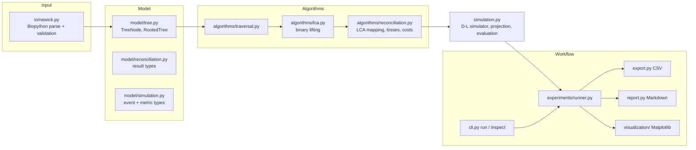
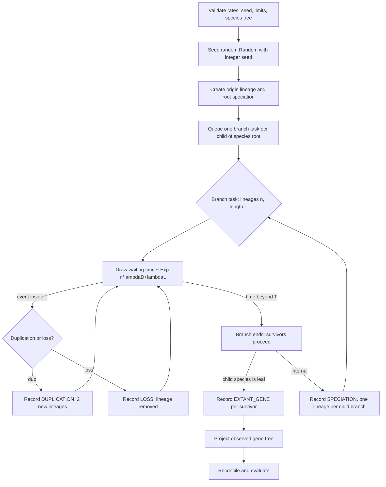

# PhyloBench: An Inspectable Python Framework for Duplication–Loss Gene Tree–Species Tree Reconciliation, Gene-Family Simulation, and Benchmarking

**Authors:** [AUTHOR NAMES — TO BE SUPPLIED]
**Affiliations:** [TO BE SUPPLIED]
**Correspondence:** [TO BE SUPPLIED]

> *Draft status.* The numerical tables and claims below have been checked against the archived trial records, summaries, source, tests, and available CI evidence. The repository does not contain the scripts that generated the complete study artifact sets, so this manuscript does not claim end-to-end regeneration of the original studies. Author names, affiliations, and correspondence details remain to be supplied; unresolved scientific and bibliographic points are listed in the verification dossier.

---

## Abstract

Gene trees can differ from species trees because of gene duplication and loss. Comparing inferred events with simulated truth requires explicit reconciliation and evaluation conventions, including a distinction between complete history and events identifiable from extant genes. We present PhyloBench, a Python package integrating validated rooted trees, strict Newick parsing, binary-lifting lowest-common-ancestor (LCA) queries, classical LCA-based duplication–loss reconciliation, seeded continuous-time duplication–loss simulation, event evaluation, reporting, visualization, a command-line interface, and automated tests. On one four-species tree with equal branch lengths, we report an exploratory study (30 full-run trials) and a 3 × 3 factorial study (900 full-run trials). In the factorial data, 69/900 families were extinct; 831 non-extinct records supported inferred metrics. The 45 pilot records repeat seed/cell combinations in the full factorial dataset and are not additional trials. At rates of 0.5 for both duplication and loss, mean branch-level loss recall was 0.590 under the evaluator's empty-denominator convention; among the 79 trials with non-empty recall denominators it was 0.559. Empty-denominator values of 1.0 are conventions, not evidence of event recovery. These descriptive results apply only to this simulator, topology, branch lengths, rate grid, and seed design. They establish neither general biological laws nor algorithmic superiority. PhyloBench does not introduce a new reconciliation algorithm; the contribution is an inspectable implementation and archived benchmark workflow, while the full original study-generation pipeline is not included in the repository.

**Keywords:** gene tree–species tree reconciliation; gene duplication and loss; lowest common ancestor; phylogenetic simulation; benchmarking; reproducible research

---

## 1. Introduction

Gene trees describe the history of homologous gene copies, whereas species trees describe the history of the organisms that carry them. The two need not agree. Gene duplication and loss, horizontal gene transfer, and incomplete lineage sorting can each produce gene trees whose topology differs from the species tree [Maddison 1997; Szöllősi et al. 2015]. Under the duplication–loss model, a gene tree is explained by mapping it into the species tree and counting the duplications and losses needed for consistency [Goodman et al. 1979; Page 1994]. This idea underlies orthology inference, the study of gene-family evolution, and a family of reconciliation tools [Doyon et al. 2011].

Developing and testing such methods needs more than an algorithm. A researcher must generate gene families whose true history is known, reconcile the observable part of each family, and compare inferred and true events under conventions that respect what an extant gene tree can and cannot reveal. A simulated history contains events, such as losses of lineages that leave no extant descendants, that no method applied to extant leaves can recover. Evaluation that ignores this distinction conflates method error with information loss.

PhyloBench is a Python research framework that places these components in one inspectable package. This paper describes its implementation and reports two simulation studies that exercise it. We deliberately limit our claims. The LCA mapping, binary-lifting LCA, and duplication–loss cost model are established techniques. PhyloBench does not propose a new reconciliation algorithm, a new LCA algorithm, or a new evolutionary model. Its contributions are:

1. an integrated implementation of rooted-tree handling, LCA-based duplication–loss reconciliation, seeded duplication–loss simulation, and evaluation, with explicit validation and resource limits;
2. evaluation conventions that keep complete simulated history separate from events identifiable in the extant tree, and that report extinction explicitly rather than imputing metrics;
3. a workflow that records fixed integer seeds and study configurations and provides CSV and Markdown export, a command-line interface, and automated tests, alongside two studies with archived raw data and summaries. The original drivers for generating the complete study artifact sets are not included.

## 2. Background and Related Work

**Reconciliation.** Goodman et al. [1979] introduced the parsimony strategy of fitting a gene lineage into its species lineage. Page [1994] formalised reconciled trees and an algorithm for computing them, and Page and Charleston [1997] discussed reconciled trees in the gene tree/species tree problem. Zmasek and Eddy [2001] gave a simple algorithm that labels each internal gene-tree node as a duplication or a speciation by comparison with a species tree. Doyon et al. [2011] reviewed reconciliation models, algorithms, and programs, including extensions to horizontal transfer. Because reconciliation presumes error-free trees, errors in an inferred gene tree can bias the inferred events: Hahn [2007] showed that reconciliation of incorrect gene trees tends to place duplications too deep in the species tree and losses too near the tips.

**Duplication–loss as a stochastic process.** Gene-family evolution along a species tree is commonly modelled as a birth–death process in which lineages duplicate and are lost at specified rates [Szöllősi et al. 2015]. Related models additionally account for incomplete lineage sorting through a locus tree [Rasmussen and Kellis 2012] or for transfer [Szöllősi et al. 2015; Morel et al. 2020].

**Simulation and inference software.** SimPhy simulates gene families under incomplete lineage sorting, duplication and loss, horizontal gene transfer, and gene conversion using a hierarchical species/locus/gene-tree model, and it can generate sequence alignments [Mallo et al. 2016]. GeneRax is a maximum-likelihood tool that infers gene-family trees from sequence alignments while accounting for duplication, transfer, and loss relative to a rooted species tree [Morel et al. 2020]; earlier probabilistic frameworks for joint species-tree and gene-tree inference include Boussau et al. [2013]. These tools are far more comprehensive than PhyloBench in the biological processes they model. PhyloBench has a narrower purpose: a compact, transparent reference implementation of the classical duplication–loss model in which the simulator, the reconciler, and the evaluation conventions can be read and tested together. We make no performance or accuracy comparison with SimPhy, GeneRax, or any other tool.

**Tree algorithms.** LCA queries on rooted trees can be answered with constant query time after linear preprocessing [Bender and Farach-Colton 2000]. PhyloBench instead uses binary lifting, a simpler technique with logarithmic queries; we did not benchmark the two. Newick parsing is delegated to Biopython's `Bio.Phylo` [Talevich et al. 2012].

## 3. Materials and Methods

### 3.1 Software architecture

PhyloBench (version 0.1.0) is a Python ≥ 3.10 package with two runtime dependencies, Biopython (≥ 1.81) and Matplotlib (≥ 3.7). Its modules are organised as follows (Figure 1).

*Figure 1. Module structure of PhyloBench (to be redrawn for publication). Arrows indicate the direction of data flow, not Python import order.*

The design follows four principles that are visible in the code. (i) *Validation at the boundary*: trees are checked for structural invariants, finite non-negative branch lengths, and unique leaf names before any algorithm runs. (ii) *Seeded execution*: simulation uses a user-supplied integer seed. (iii) *Separation of complete and observed history*: the simulator retains the full event history and a separate projected observed gene tree. (iv) *Explicit resource limits*: exceeding configured event or lineage limits raises an exception. The repository has 64 automated test items covering tree models, Newick errors, traversal, LCA, reconciliation, simulation invariants, CLI, export, reports, and figure generation. At the latest verified `main` commit (7b07689), GitHub Actions passed on Python 3.10, 3.11, 3.12, and 3.13; the Python 3.12 job collected and passed all 64 items. See the verification dossier for the run record. This is test and CI evidence, not external scientific validation.

### 3.2 Tree representation and LCA

A `TreeNode` carries a stable non-negative integer identifier, an optional label, an optional branch length, a parent reference, and an ordered child list. A `RootedTree` is defined by its root. Adding a child is rejected if it would create a cycle, attach a second parent, or place a node in two trees. Calling `freeze()` (done automatically when an LCA index is built) forbids later topology changes. `validate_tree` iteratively verifies parent pointers, identifier uniqueness, branch-length validity, leaf-name presence and uniqueness, and, optionally, that every internal node has exactly two children.

Newick input is parsed with Biopython. Before parsing, PhyloBench requires exactly one tree with a single terminal semicolon and rejects empty, malformed, negative, or non-finite branch lengths. The Biopython clade structure is then converted to the internal model with an explicit stack, and the result is validated. Pre-order and post-order traversals are likewise iterative, so deep trees do not exhaust the Python recursion limit; the test suite includes a deep-tree case.

For LCA queries, `LCAIndex` stores node depths and a table `up[k][v]` holding the 2^k-th ancestor of node *v* (the root is its own ancestor). A query first lifts the deeper node to the depth of the shallower one using the binary representation of the depth difference, and, if the nodes then differ, lifts both simultaneously from the largest level downward. By code inspection, table construction uses O(*n* log *n*) time and space and each query uses O(log *n*) time for a tree with *n* nodes. We did not measure scaling empirically.

### 3.3 Reconciliation methodology

**Model and assumptions.** Let *S* be a rooted binary species tree with root ρ, node depth δ(·) (the number of edges from ρ), and leaf set *L(S)*. Let *G* be a rooted binary gene tree with leaf set *L(G)* and an explicit leaf-to-species map σ : *L(G)* → *L(S)*. The implementation assumes complete taxon sampling and vertical inheritance only (speciation, duplication, loss). Both trees must be binary, and PhyloBench raises an error if a gene leaf has no mapping or maps to an unknown species. If no mapping is supplied, gene-leaf names must equal species-leaf names.

**LCA mapping.** The map *M* : *V(G)* → *V(S)* is defined by *M(g)* = σ(*g*) for a leaf and *M(g)* = LCA_*S*(*M(g₁)*, *M(g₂)*) for an internal node *g* with children *g₁* and *g₂*, computed in post-order. An internal node is classified as a **duplication** if *M(g)* ∈ {*M(g₁)*, *M(g₂)*} and as a **speciation** otherwise.

**Loss inference.** The family is assumed to originate at ρ. For every transition from a gene node *g* to a child *g′*, let *u* = *M(g)* and *w* = *M(g′)*; *w* is a descendant of *u* (or equal to it). Walking the species-tree path from *u* to *w*, one loss event is recorded on each species branch that leaves the path, that is, at each split on the path the sibling branch not taken. Following the implemented convention, a duplication transition counts the split at *u* itself, whereas a speciation transition skips it, because that split is the speciation already represented in *G*. The family-origin transition runs from ρ to *M(root of G)* and counts all splits. Each loss is stored as a (species-parent, species-child) branch together with the gene transition that produced it, so that two independent copies lost on the same branch produce two records. Because *S* is binary, each counted split contributes exactly one loss, and the loss count simplifies to

Λ = [δ(*M(r_G)*) − δ(ρ)] + Σ_{(g,g′)∈E(G)} [ δ(*M(g′)*) − δ(*M(g)*) − *s(g)* ],

where *r_G* is the root of *G*, *E(G)* is the set of parent–child edges of *G*, and *s(g)* = 1 if *g* is a speciation and 0 if it is a duplication. With *D* the number of duplications, the reconciliation cost is

*C* = *c_D* · *D* + *c_L* · Λ,

where *c_D* and *c_L* are non-negative duplication and loss costs (both 1 in the studies reported here). By code inspection, mapping takes O(*g* log *s*) for *g* gene nodes and *s* species nodes, while enumerating species-tree paths for losses takes O(*g h*) in the worst case for species-tree height *h*. This is a source-level complexity analysis, not an empirical scaling result; no scaling benchmarks are archived.

**Worked example.** The test suite encodes the following case (Table 1). With species tree `((A,C)X,B)R` and gene tree `(((A1,C1)s,A2)d2,A3)d1`, where A1, A2, A3 map to A and C1 maps to C, the reconciler assigns *s* to speciation at X and both *d2* and *d1* to duplications mapped to X. The origin transition from R to X contributes one loss on branch (R, B); the two duplication transitions to A2 and A3 each contribute one loss on branch (X, C). Thus *D* = 2, Λ = 3, and *C* = 5 under unit costs. Two losses on the same species branch remain separate records.

**Table 1. Worked reconciliation example (from `tests/test_reconciliation.py`).**

| Gene node | Event | Mapped species node |
|---|---|---|
| s | speciation | X |
| d2 | duplication | X |
| d1 | duplication | X |

| Loss branch (parent, child) | Count |
|---|---:|
| (R, B) | 1 |
| (X, C) | 2 |

The loss convention is covered by hand-derived cases in the test suite; we did not cross-validate it against external reconciliation software.

### 3.4 Evolutionary simulation model

**Process.** The simulator evolves one gene family along a fixed, rooted, binary species tree whose non-root nodes have positive finite branch lengths (interpreted as time). Let λ_D and λ_L be the per-lineage duplication and loss rates, constant in time and across branches. On a branch of length *T* entered by *n* active lineages, the waiting time to the next event is exponential with rate *n*(λ_D + λ_L); if the event time would fall beyond *T*, the branch ends. Otherwise a lineage is chosen uniformly at random; with probability λ_D / (λ_D + λ_L) it duplicates (replaced by two daughter lineages) and otherwise it is lost. Because the exponential distribution is memoryless, this is equivalent to independent linear birth–death processes on each lineage. If λ_D + λ_L = 0 no events occur. Species-tree speciation is deterministic: at the end of an internal branch every surviving lineage splits into one lineage per child species. A virtual origin lineage is created above ρ and undergoes the root speciation (Figure 2).

*Figure 2. Simulation workflow. Event and lineage limits are checked whenever an event or lineage is created.*

**Complete history and observed tree.** Every origin, speciation, duplication, loss, and extant-gene event is stored with its gene node, lineage, species branch, and time on the branch. The *observed gene tree* is obtained by removing the virtual origin, discarding subtrees that contain no extant gene, and collapsing nodes left with a single child, while preserving the original node identifiers. If no extant gene survives, the family is **extinct** and no observed tree exists.

**Limits.** If recording another event would exceed `max_events`, or allocating another lineage would exceed `max_lineages` (defaults 100,000 and 10,000), the simulator raises `SimulationLimitExceeded`. `run_experiment` does not catch this exception, so a violating trial aborts the run rather than returning a silently truncated family.

**Reproducibility.** Randomness comes from Python's `random.Random(seed)` with an integer seed, and fixed-seed repeatability is covered by a test. The experiment metadata records the study configurations and seeds. The repository does not include the original scripts for generating the complete study artifacts or a dependency lockfile, and cross-version identity of random streams is unverified. The archived records can be inspected and summarized; this should not be read as a claim that the full original study pipeline is packaged for exact regeneration.

### 3.5 Evaluation metrics

For a non-extinct trial, the observed tree is reconciled with the species tree using the leaf-to-species map recorded during simulation, and the following quantities are computed. Let *V_obs* be the internal nodes of the observed tree. Each *v* ∈ *V_obs* has a true type (speciation or duplication) and a true species location from the complete history, and an inferred type and location *M(v)* from reconciliation.

- **Event counts and cost.** Inferred duplications *D̂*, inferred losses Λ̂, and inferred cost *Ĉ* from Section 3.3, alongside *complete* simulated duplication and loss counts. Complete counts include events invisible in the extant tree (for example, a duplication whose descendants were all lost).
- **Exact speciation-location agreement.** Among nodes whose true and inferred types are both speciation, the fraction with *M(v)* equal to the true species node. This is the quantity stored as `exact_event_location_agreement`; despite the name, it applies to speciation nodes only.
- **Duplication branch compatibility.** Among nodes whose true and inferred types are both duplication, the fraction for which *M(v)* equals or lies below *c(v)*, the child end of the species branch on which the duplication occurred. This does not establish recovery of the exact duplication time, which is not identifiable from extant leaves.
- **Loss precision and recall.** Let Î be the multiset of species branches carrying inferred losses. A simulated loss is *identifiable* if the lineage that was lost was created by a speciation or duplication split in which at least one sibling lineage has an extant descendant; let *I* be the multiset of species branches of identifiable losses. Precision is |Î ∩ *I*| / |Î| and recall is |Î ∩ *I*| / |*I*|, using multiset intersection. When a denominator is empty the implementation returns 1.0. The same convention applies to exact speciation-location agreement and duplication-branch compatibility when their evaluated event denominators are empty. A convention-assigned 1.0 is not evidence of event recovery. Hidden losses are excluded from recall rather than counted as misses. Matching branches does not establish exact historical loss-event recovery.

The evaluator also computes the number of type-matched nodes and the signed duplication-count error, but the experiment runner does not write these to the trial CSV; they are therefore not analysed here (Section 6).

### 3.6 Experimental design

Both studies use the species tree `((A:1,B:1)AB:1,(C:1,D:1)CD:1)ROOT;`, unit duplication and loss costs, and simulator limits of 100,000 events and 10,000 lineages (Table 2). Each trial is one simulated family reconciled against this tree. The first study has 30 full-run trials across three equal-rate tiers; its pilot ran seeds 101–103 in each tier, which are included again in the 10-seed full run. The second study has 900 full-run trials across nine rate combinations; its pilot ran seeds 1001–1005 in each cell, which are included again in the 100-seed full run. The pilot executions are repeated seed/cell combinations, not additional independent observations: the archived full datasets contain 30 and 900 rows, not 39 and 945. The same seed IDs are also reused across factorial conditions, so outcomes may be dependent across cells. The analysis reports descriptive contrasts and does not estimate uncertainty for paired cross-condition contrasts. In the archived first-study pilot data, no trial is extinct; in the second-study pilot data, three of 45 trials are extinct (one of five at λ_D = 0.1, λ_L = 0.5 and two of five at λ_D = λ_L = 0.5). The archive does not report limit-exception counts for pilot or full runs.

**Table 2. Experimental design.**

| | Study 1 (exploratory) | Study 2 (factorial) |
|---|---|---|
| Trials | 30 | 900 |
| Duplication rate λ_D | 0.01, 0.1, 0.5 (tied to λ_L) | 0.01, 0.1, 0.5 |
| Loss rate λ_L | 0.01, 0.1, 0.5 (tied to λ_D) | 0.01, 0.1, 0.5 |
| Conditions | 3 | 9 (3 × 3) |
| Seeds per condition | 10 (101–110) | 100 (1001–1100) |
| Species tree | `((A:1,B:1)AB:1,(C:1,D:1)CD:1)ROOT;` | same |
| Costs *c_D*, *c_L* | 1, 1 | 1, 1 |
| Limits (events, lineages) | 100,000; 10,000 | 100,000; 10,000 |

The same seed values are reused across the cells of Study 2; any dependence this induces was not examined.

*Archived-data check.* The raw files contain 30 Study 1 and 900 Study 2 full-run rows. In each study, every pilot seed/cell record exactly matches its corresponding full-run row. Study configurations and seeds are archived, but the original full study-generation scripts and the scripts for the study figures and derivative tables are not; the repository therefore does not package the complete experiment-generation pipeline.

### 3.7 Statistical analysis

The analysis is descriptive. For each condition and metric we report the mean and the sample standard deviation (*n* − 1 denominator). Complete-history counts use all trials; inferred metrics use non-extinct trials only, so their denominators are the valid-trial counts. Bounded-metric means include 1.0 values assigned by the empty-denominator convention; for loss precision and recall, Table 5 also gives results restricted to non-empty denominators. The Monte Carlo standard error is the sample standard deviation divided by √*n*. The repository's audit reports normal-approximation 95% intervals (mean ± 1.96 MCSE) for counts and cost, Wilson score intervals for extinction frequency, and percentile-bootstrap intervals (20,000 resamples, deterministic seeds derived from the cell and metric names) for bounded per-trial metrics [Wilson 1927; Efron 1979]. Marginal means and high-minus-low contrasts are descriptive; no hypothesis tests are performed. Recomputed means and sample standard deviations for all 99 metric–cell rows and Wilson intervals for all nine extinction rates agree with the archived summaries and audit file. The bootstrap intervals were not independently recomputed in this review. Intervals quantify Monte Carlo uncertainty conditional on this simulator, tree, seed design, and analysis; they do not reflect model or topology uncertainty, and the cell-wise intervals do not quantify paired cross-condition contrasts.

## 4. Results

### 4.1 Exploratory study

In the 30-trial study no family went extinct. Mean complete duplications were 0.10, 0.20, and 3.80, and mean complete losses 0.00, 0.40, and 3.10, in the low, medium, and high tiers (Table 3). Mean inferred cost was 0.10, 0.60, and 3.60. Loss precision and recall were 1.00 in the low and medium tiers and 0.85 and 0.60 in the high tier. With ten trials per tier the standard deviations are large relative to the means in the high tier, and the study is best viewed as a feasibility check.

**Table 3. Study 1 (10 trials per tier; mean (SD)).**

| Tier | λ_D = λ_L | Trials | Extinct | Complete duplications | Complete losses | Inferred cost | Loss precision | Loss recall |
|---|---:|---:|---:|---|---|---|---:|---:|
| low | 0.01 | 10 | 0 | 0.10 (0.32) | 0.00 (0.00) | 0.10 (0.32) | 1.00 | 1.00 |
| medium | 0.1 | 10 | 0 | 0.20 (0.42) | 0.40 (0.52) | 0.60 (0.70) | 1.00 | 1.00 |
| high | 0.5 | 10 | 0 | 3.80 (2.57) | 3.10 (1.45) | 3.60 (2.46) | 0.85 | 0.60 |

### 4.2 Factorial experiment: overview

Table 4 gives the nine conditions. Of the 900 archived trials, 69 (7.7%) were extinct and 831 supported inference. If recording another event would exceed `max_events`, or allocating another lineage would exceed `max_lineages`, the simulator raises `SimulationLimitExceeded`; the experiment runner does not catch that exception to return a truncated trial. The archive contains no limit-exception ledger, and complete duplication/loss counts do not measure all recorded events or lineage allocations, so the data do not establish whether any other simulation attempts reached a limit. Mean complete duplications ranged from 0.01 to 5.50 across cells, mean complete losses from 0.04 to 3.41, and mean inferred cost (non-extinct trials) from 0.09 to 5.52.

**Table 4. Study 2: nine conditions (100 trials each). Extinction: count (Wilson 95% interval, %). Counts and cost: mean (SD); inferred quantities use the valid trials.**

| λ_D | λ_L | Extinct | Valid | Complete dup. | Complete loss | Inferred dup. | Inferred loss | Inferred cost |
|---:|---:|---|---:|---|---|---:|---:|---|
| 0.01 | 0.01 | 0/100 (0.0–3.7) | 100 | 0.05 (0.22) | 0.04 (0.20) | 0.05 | 0.04 | 0.09 (0.32) |
| 0.01 | 0.1 | 1/100 (0.2–5.4) | 99 | 0.06 (0.24) | 0.55 (0.66) | 0.06 | 0.51 | 0.57 (0.59) |
| 0.01 | 0.5 | 27/100 (19.3–36.4) | 73 | 0.01 (0.10) | 1.78 (0.80) | 0.01 | 1.42 | 1.44 (0.67) |
| 0.1 | 0.01 | 0/100 (0.0–3.7) | 100 | 0.61 (0.82) | 0.10 (0.30) | 0.61 | 0.10 | 0.71 (0.86) |
| 0.1 | 0.1 | 2/100 (0.6–7.0) | 98 | 0.53 (0.88) | 0.63 (0.65) | 0.48 | 0.53 | 1.01 (1.01) |
| 0.1 | 0.5 | 24/100 (16.7–33.2) | 76 | 0.25 (0.52) | 1.97 (0.92) | 0.13 | 1.45 | 1.58 (0.72) |
| 0.5 | 0.01 | 0/100 (0.0–3.7) | 100 | 5.50 (4.28) | 0.12 (0.36) | 5.45 | 0.07 | 5.52 (4.21) |
| 0.5 | 0.1 | 0/100 (0.0–3.7) | 100 | 5.11 (4.24) | 1.00 (1.10) | 4.69 | 0.54 | 5.23 (3.99) |
| 0.5 | 0.5 | 15/100 (9.3–23.3) | 85 | 3.57 (3.90) | 3.41 (2.49) | 2.46 | 1.42 | 3.88 (2.94) |

*Complete duplication and loss means use all 100 trials per cell (including extinct families); inferred means use the valid trials. Figure: `experiments/2026-10-30-second-study/figures/heatmap_*.png`.*

### 4.3 Duplication-rate effects

Averaged over loss rates, mean complete duplications rose from 0.04 (λ_D = 0.01) to 0.46 (0.1) to 4.73 (0.5), and the variability within cells grew with the mean (cell SDs of 0.10–0.24, 0.52–0.88, and 3.90–4.28, respectively). Mean complete losses also increased modestly with λ_D (0.79, 0.90, 1.51), which is expected because more lineages are exposed to loss. The cell means of complete duplications at λ_L = 0.01 can be compared with a closed-form expectation. Under pure duplication (λ_L = 0) on this tree, each of the two root-child subtrees contributes (e^λ − 1)(1 + 2e^λ) expected duplications, giving 2(e^λ − 1)(1 + 2e^λ) in total, which is 0.061, 0.675, and 5.576 for λ_D = 0.01, 0.1, and 0.5. The observed means at λ_L = 0.01 were 0.05, 0.61, and 5.50, consistent with these values relative to the reported Monte Carlo standard errors (0.022, 0.082, 0.43). This is an approximate analytical check because λ_L is small but nonzero; the derivation is not part of the repository and is not covered by an automated test.

### 4.4 Loss-rate effects

Averaged over duplication rates, mean complete losses rose steeply with λ_L: 0.09 (λ_L = 0.01), 0.73 (0.1), and 2.39 (0.5). Mean complete duplications declined with λ_L (2.05, 1.90, 1.28) because lost lineages cannot duplicate. Loss rate was also the driver of extinction (Section 4.5).

### 4.5 Extinction patterns

All 69 extinct families occurred at λ_L ≥ 0.1: none at λ_L = 0.01, 3 of 300 (1.0%) at λ_L = 0.1, and 66 of 300 (22.0%) at λ_L = 0.5 (Figure 3). At λ_L = 0.5, extinction frequency was 27%, 24%, and 15% at λ_D = 0.01, 0.1, and 0.5. The Wilson intervals for these three cells overlap (19.3–36.4, 16.7–33.2, and 9.3–23.3 %), so this decline with duplication rate is descriptive and should not be read as a tested effect; it is directionally what one expects if duplication creates additional copies that buffer against loss.

A pure-loss process on this tree admits a closed form. With *p* = e^{−λ_L} and a branch length of 1, a lineage entering one root-child branch yields at least one extant gene with probability *p*[1 − (1 − *p*)²], and the family is extinct if neither of the two root-child lineages does, i.e. with probability {1 − *p*[1 − (1 − *p*)²]}². This gives 0.0001, 0.0107, and 0.2375 for λ_L = 0.01, 0.1, and 0.5. The observed frequencies at λ_D = 0.01 (0.00, 0.01, 0.27) are compatible with these values relative to their Wilson intervals; this comparison is approximate because λ_D is small but nonzero. This calculation is derived from the described process and is not an automated test of the implementation.

*Figure 3. Extinction frequency in the 3 × 3 factorial study (existing repository figure, `experiments/2026-10-30-second-study/figures/heatmap_extinction_frequency.png`).*

### 4.6 Reconciliation cost observations

Because *c_D* = *c_L* = 1, the inferred cost equals the number of inferred duplications plus inferred losses in every one of the 831 valid trials. Averaged over valid trials, inferred cost increased with duplication rate (0.63, 1.06, 4.93 at λ_D = 0.01, 0.1, 0.5) and only slightly with loss rate (2.11, 2.28, 2.37). At λ_D = 0.5, however, the cell mean *decreased* with loss rate (5.52, 5.23, 3.88; Figure 4). This pattern should be interpreted with care: higher λ_L removes lineages and, at λ_L = 0.5, removes whole families, so the cost is computed on a progressively selected subset of survivors, and the duplications that survive in the extant tree are fewer.

*Figure 4. Cell means of inferred cost by duplication rate and by loss rate (existing repository figure, `experiments/2026-10-30-second-study/figures/main_effects_inferred_cost.png`). Means are over valid trials and carry no interval information.*

**Inferred versus complete events.** In none of the 831 valid trials did the number of inferred duplications exceed the number of complete simulated duplications; in 109 trials it was smaller. The shortfall was negligible at λ_D = 0.01 (mean 0.00), small at λ_D = 0.1 (0.07), and larger at λ_D = 0.5 (0.67). In the highest-rate cell, the valid trials had a mean of 4.15 complete duplications (computed by us from the raw CSV; Table 4 reports the all-trial mean of 3.57) but only 2.46 inferred duplications. Likewise the mean number of identifiable losses in that cell (2.71, Table 5) exceeded the mean number of inferred losses (1.42, Table 4).

**Location metrics.** The raw CSV reports exact speciation-location agreement and duplication-branch compatibility as 1.0 in all 831 non-extinct trials. This is not evidence of high accuracy: the observed gene tree is an error-free projection of the simulated history, and the evaluator assigns 1.0 when either metric's denominator is empty. For non-empty denominators, the definitions and tree projection imply the same result in this setup: extant descendants of a true duplication lie below the child end of its species branch, while descendants of a surviving true speciation occur on both sides of the split. Thus these metrics are uninformative for accuracy in this design. The raw CSV omits their event-denominator counts, so the number of convention-assigned versus observed 1.0 values cannot be separated. The evaluator can classify a true duplication as a speciation when descendants of its two copies survive on opposite sides of a later species split, but the event-type agreement counts are not exported (Section 6).

**Loss precision and recall.** Under the implemented convention (Table 5), mean loss precision was 1.00 where losses were rare and between 0.88 and 0.98 in cells with λ_L ≥ 0.1. Mean loss recall was 1.00 at λ_D = 0.01 and decreased with duplication rate at λ_L ≥ 0.1, reaching 0.76 at (0.5, 0.1) and 0.59 at (0.5, 0.5). Two cautions apply. First, the "vacuous equals 1" convention affects many trials: 470 of 831 valid trials (56.6%) have no inferred loss, so precision is convention-assigned 1.0, and 449 (54.0%) have no identifiable loss, so recall is convention-assigned 1.0. Restricting each mean to trials with a non-empty denominator (last two columns of Table 5) lowers precision to 0.86–0.96 in the cells with λ_L ≥ 0.1, and recall to 0.55–0.59 at λ_D = 0.5. In those three cells, recall denominators are non-empty in 11/100, 60/100, and 79/85 valid trials (with corresponding means 0.545, 0.593, and 0.559). Second, a loss being *identifiable* in the sense of Section 3.5 is a necessary-type condition (a loss with no extant sibling witness cannot be recovered) but is not sufficient for recovery by LCA reconciliation, so recall below 1 reflects both information loss and the parsimony of the reconciliation. We did not separate these effects.

**Table 5. Loss-branch metrics among valid trials (means). "Repo convention" averages all valid trials with empty denominators set to 1. "Non-empty" restricts to trials with a non-empty denominator (*n* trials / mean); these last two columns were computed by us from the raw CSV.**

| λ_D | λ_L | Mean identifiable losses | Precision (repo) | Recall (repo) | Precision (non-empty) | Recall (non-empty) |
|---:|---:|---:|---:|---:|---|---|
| 0.01 | 0.01 | 0.04 | 1.000 | 1.000 | 4 / 1.000 | 4 / 1.000 |
| 0.01 | 0.1 | 0.47 | 0.970 | 1.000 | 45 / 0.933 | 42 / 1.000 |
| 0.01 | 0.5 | 1.25 | 0.877 | 1.000 | 66 / 0.864 | 61 / 1.000 |
| 0.1 | 0.01 | 0.10 | 1.000 | 1.000 | 10 / 1.000 | 10 / 1.000 |
| 0.1 | 0.1 | 0.56 | 0.980 | 0.954 | 48 / 0.958 | 50 / 0.910 |
| 0.1 | 0.5 | 1.43 | 0.895 | 0.941 | 69 / 0.884 | 65 / 0.931 |
| 0.5 | 0.01 | 0.12 | 1.000 | 0.950 | 6 / 1.000 | 11 / 0.545 |
| 0.5 | 0.1 | 0.90 | 0.975 | 0.756 | 43 / 0.942 | 60 / 0.593 |
| 0.5 | 0.5 | 2.71 | 0.908 | 0.590 | 70 / 0.888 | 79 / 0.559 |

**Comparison between studies.** The three diagonal cells of Study 2 (0.01/0.01, 0.1/0.1, 0.5/0.5) correspond to the three tiers of Study 1 and use non-overlapping seed IDs with ten times more trials. Mean complete duplications were 0.10, 0.20, 3.80 in Study 1 and 0.05, 0.53, 3.57 in Study 2; mean complete losses were 0.00, 0.40, 3.10 versus 0.04, 0.63, 3.41. The differences are descriptive, and the larger study supersedes the exploratory one for estimation purposes.

## 5. Discussion

The implementation and the studies are consistent with each other and with the checks described above. The reconciliation code is covered by hand-derived tests, and the simulator's observed extinction frequencies and mean duplication counts are compatible with the manuscript's closed-form expectations for nearby pure-loss and pure-duplication cases (Sections 4.3 and 4.5). These checks support the implementation on the scenarios examined, but they are not a substitute for external validation, such as comparison with established reconciliation programs. Because the original study drivers are absent, the repository does not itself reproduce the complete study artifact pipeline from configurations to all tables and figures.

The substantive pattern in the data is that the complete simulated history and the history visible in the extant tree diverge as duplication and loss become jointly frequent. At duplication and loss rates of 0.5, valid trials carry on average 4.15 complete duplications but 2.46 inferred duplications, and 2.71 identifiable losses but 1.42 inferred losses. Extinction removes a further 15% of families at that setting, and the survivors are a selected subset. These observations are expected qualitatively from the classical model, in which reconciliation seeks a parsimonious explanation of the extant tree and cannot see events that leave no trace, but we have not attributed the divergence to particular mechanisms. Two features of the evaluation design matter for interpretation. First, the observed gene trees are error-free, so the results isolate the information lost to extinction and projection plus the parsimony of LCA reconciliation; they say nothing about errors in inferred gene trees, which Hahn [2007] showed can bias reconciliation substantially. Second, as argued in Section 4.6, the two location metrics are saturated by construction in this design, so the informative quantities are the event counts, the loss precision and recall, and (when exported) the rate of event-type disagreement.

Relative to existing tools, PhyloBench trades breadth for transparency. SimPhy models many more processes and can emit sequence alignments [Mallo et al. 2016], and GeneRax performs maximum-likelihood inference from sequences [Morel et al. 2020]. PhyloBench has neither capability. Its intended role is a compact reference environment in which the classical model, the simulator, and the evaluation conventions are inspectable, seeded, and testable together, for example as a regression benchmark for reconciliation code or as teaching material. Whether PhyloBench's conventions yield conclusions comparable to those from other simulators is not addressed here.

## 6. Limitations

1. **One species-tree topology and one branch-length scale.** All experiments use a single four-species balanced tree in which every branch has the same specified length (1).
2. **Constant rates.** Duplication and loss rates are constant within and across branches and among lineages.
3. **Classical model.** Reconciliation uses the classical rooted, binary, LCA-based duplication–loss model with complete taxon sampling and unit costs; polytomies and non-unit costs were not evaluated experimentally.
4. **Simplified biology.** The simulator is far simpler than real genome evolution. It does not model horizontal gene transfer, incomplete lineage sorting, gene conversion, sequence evolution, or rate heterogeneity, and it starts every family with a single copy at the species-tree root.
5. **Error-free gene trees.** Observed trees are exact projections of the simulated history, so no gene-tree inference error is present.
6. **Extinction and conditioning.** Extinct families (69 of 900) have no observed tree. Inferred and loss metrics are therefore conditional on survival, particularly at λ_L = 0.5, where 15–27% of trials are lost, and they are not unconditional population quantities.
7. **Complete versus inferable history.** Complete simulated counts include hidden events that no method could infer from extant leaves; they should not be treated as the target of inference.
8. **Branch-level loss matching.** Matching inferred and simulated losses by species branch does not establish exact recovery of historical loss events, and precision and recall are averaged with a convention that sets empty-denominator cases to 1.
9. **Duplication compatibility.** Duplication branch compatibility does not establish exact duplication-time recovery, and it is saturated in this design.
10. **Missing exported metrics.** The event-type agreement rate and the signed duplication-count error are computed but not exported, so they could not be analysed.
11. **Statistics.** Analyses are descriptive; seed values are reused across cells; the intervals are conditional on this simulator and seed set; and pilot seeds are a subset of the main-run seeds.
12. **Software provenance.** The scripts that produced the study files and figures, the Python and package versions used originally, and the code revision are not recorded in the repository. The latest verified `main` commit passed GitHub Actions on Python 3.10–3.13; see the verification dossier. The local review environment did not have the test dependencies installed, so the suite was not rerun locally.
13. **No general claims.** The results do not establish general biological laws, scaling relationships, or the superiority of any algorithm.

## 7. Conclusion and Future Work

PhyloBench provides a compact, tested environment for duplication–loss reconciliation research: validated rooted trees, LCA-based reconciliation with explicit loss conventions, a seeded simulator that retains complete history, and evaluation and reporting tools. Two archived studies on one four-species tree describe how complete and observable histories differ over the tested rate grid. Their results are conditional on the design and do not establish algorithmic novelty or biological generality. The repository preserves raw records and configurations, but not the full study-generation pipeline.

Concrete next steps, each requiring new work, are: (i) export event-type agreement and duplication-count error; (ii) add gene-tree error (for example by inference from simulated sequences) so that the location metrics become informative; (iii) vary species-tree topology, size, and branch lengths; (iv) cross-validate loss counts against established reconciliation software; (v) add scaling benchmarks for the LCA and reconciliation routines; and (vi) record software versions, code revision, and the study-generation scripts alongside each experiment.

## 8. Data and Code Availability

The code, tests, raw trial data, summaries, figures, and reports are in the [PhyloBench GitHub repository](https://github.com/oma452/PhyloBench). Study artifacts are under `experiments/2026-10-30-first-study/` and `experiments/2026-10-30-second-study/`, including `raw/all_trials.csv`, `metadata/study_configuration.json`, `summary/`, `reports/`, `figures/`, and `analysis/statistical_audit.py`. The repository does not include the original scripts for generating the study runs and figures, a dependency lockfile, a LICENSE, or a CITATION file. The author names, affiliations, and correspondence details above require author input. Original study-generation software versions and code revision are not recorded in the experiment metadata.

## References

Boussau B, Szöllősi GJ, Duret L, Gouy M, Tannier E, Daubin V (2013) Genome-scale coestimation of species and gene trees. *Genome Research* 23(2):323–330. https://doi.org/10.1101/gr.141978.112

Bender MA, Farach-Colton M (2000) The LCA problem revisited. In: *LATIN 2000: Theoretical Informatics*, Lecture Notes in Computer Science 1776, pp 88–94. Springer. https://doi.org/10.1007/10719839_9

Doyon J-P, Ranwez V, Daubin V, Berry V (2011) Models, algorithms and programs for phylogeny reconciliation. *Briefings in Bioinformatics* 12(5):392–400. https://doi.org/10.1093/bib/bbr045

Efron B (1979) Bootstrap methods: another look at the jackknife. *The Annals of Statistics* 7(1):1–26. https://doi.org/10.1214/aos/1176344552

Goodman M, Czelusniak J, Moore GW, Romero-Herrera AE, Matsuda G (1979) Fitting the gene lineage into its species lineage, a parsimony strategy illustrated by cladograms constructed from globin sequences. *Systematic Zoology* 28:132–163. [DOI not verified]

Hahn MW (2007) Bias in phylogenetic tree reconciliation methods: implications for vertebrate genome evolution. *Genome Biology* 8(7):R141. https://doi.org/10.1186/gb-2007-8-7-r141

Maddison WP (1997) Gene trees in species trees. *Systematic Biology* 46(3):523–536. https://doi.org/10.1093/sysbio/46.3.523

Mallo D, De Oliveira Martins L, Posada D (2016) SimPhy: phylogenomic simulation of gene, locus, and species trees. *Systematic Biology* 65(2):334–344. https://doi.org/10.1093/sysbio/syv082

Morel B, Kozlov AM, Stamatakis A, Szöllősi GJ (2020) GeneRax: a tool for species-tree-aware maximum likelihood-based gene family tree inference under gene duplication, transfer, and loss. *Molecular Biology and Evolution* 37(9):2763–2774. https://doi.org/10.1093/molbev/msaa141

Page RDM (1994) Maps between trees and cladistic analysis of historical associations among genes, organisms, and areas. *Systematic Biology* 43(1):58–77. https://doi.org/10.1093/sysbio/43.1.58

Page RDM, Charleston MA (1997) From gene to organismal phylogeny: reconciled trees and the gene tree/species tree problem. *Molecular Phylogenetics and Evolution* 7:231–240. [DOI not verified]

Rasmussen MD, Kellis M (2012) Unified modeling of gene duplication, loss, and coalescence using a locus tree. *Genome Research* 22(4):755–765. https://doi.org/10.1101/gr.123901.111

Szöllősi GJ, Tannier E, Daubin V, Boussau B (2015) The inference of gene trees with species trees. *Systematic Biology* 64(1):e42–e62. https://doi.org/10.1093/sysbio/syu048

Talevich E, Invergo BM, Cock PJA, Chapman BA (2012) Bio.Phylo: a unified toolkit for processing, analyzing and visualizing phylogenetic trees in Biopython. *BMC Bioinformatics* 13:209. https://doi.org/10.1186/1471-2105-13-209

Wilson EB (1927) Probable inference, the law of succession, and statistical inference. *Journal of the American Statistical Association* 22(158):209–212. https://doi.org/10.1080/01621459.1927.10502953

Zmasek CM, Eddy SR (2001) A simple algorithm to infer gene duplication and speciation events on a gene tree. *Bioinformatics* 17(9):821–828. PMID: 11590098
